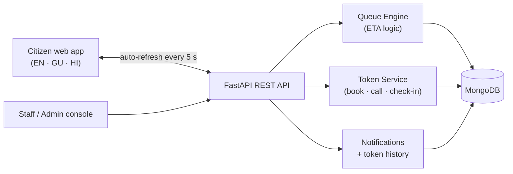

<div align="center">

# 🎟️ QueueLess

### The queue isn't the problem. Not being able to see it is.

**A virtual token and wait-time prediction system for government offices.**
Take a token from your phone. See your wait. Arrive when your turn is near.

`Python` · `FastAPI` · `MongoDB` · `JavaScript` · `English / ગુજરાતી / हिन्दी`

Built for **Code Carnival 3.0** (ADSC, Atmiya University) · Problem Statement **PS-02**

[Demo video](#-demo) · [Quick start](#-quick-start) · [How the prediction works](#-how-the-wait-time-is-calculated) · [Status](#-current-status-honest)

</div>

---

## The problem

Imagine a shop owner who closes her shop for a whole morning to renew a driving licence. Her turn would have come at 11:40, but nobody told her. She stood in line since 9.

Government offices make citizens pay for a place in line with their whole day:

- **One counter serves about 3 licences an hour** (18 minutes each in our model).
- If 20 people join the queue, **the last one waits nearly 6 hours** (19 × 18 = 342 min).
- Because nobody can see the queue, **everyone arrives early "to be safe"** and waits in person.

Daily wagers, senior citizens and working parents lose the most, because a lost day is lost income.

## 💡 Our idea

**QueueLess separates *being in line* from *standing in line*.**

| Today | With QueueLess |
| --- | --- |
| Arrive 9 AM → paper token → wait for hours → service | Pick service → token + live ETA → go on with your day → leave-by time → arrive just in time → QR check-in → service |

The queue moves from the office corridor to the citizen's phone. Online and walk-in citizens stay in **one queue**, so nobody is left out.

## ✨ Features

**For citizens**
- 🎫 **Virtual token** for a chosen service, date and 30-minute slot (daily cap and one active token per citizen keep it fair)
- ⏱️ **Live ETA** with people ahead, wait time and expected service time, **with a plain-language reason** for the estimate
- 🚗 **Leave-by time** = ETA − commute − 10-minute buffer
- 📄 **Required-documents checklist** per service, so no wasted trip
- 🌐 **English, Gujarati and Hindi** interface
- 📅 Calendar view, token history, in-app notifications

**For staff and admins**
- ▶️ Call the next token to a counter, mark tokens completed or missed
- 🚶 Issue **walk-in tokens** into the same queue
- 🪟 Open or close counters, change the daily token capacity
- 📊 Live queue overview: waiting, serving, completed, missed, remaining capacity

## 🧮 How the wait time is calculated

No black box. The queue engine (`backend/app/services/queue_engine.py`) is a transparent, rule-based model

```
```

- **Peak factor** rises in the morning rush (1.30× between 10 AM and noon) and falls in quiet hours.
- **Open counters** come from the live counter state, so closing a counter changes every ETA.
- **Leave-by time** subtracts commute and a 10-minute buffer from the ETA.

**Worked example.** Driving licence at 10:15 AM, 7 people ahead, 3 counters, 18 min each, peak factor 1.30:

`(8 × 18) ÷ 3 × 1.30 = 62 min` → ETA **11:17 AM** → with 25 min commute + 10 min buffer, **leave by 10:42 AM**.

> The prediction is deliberately explainable. A trained model is planned once real service times are logged (see the [roadmap](#-roadmap)).

## 🏗️ Architecture



## 🛠️ Tech stack

| Layer | Technology |
| --- | --- |
| Frontend | JavaScript (ES modules), HTML, CSS (served by the same FastAPI server) |
| Backend | Python 3.11, FastAPI, Pydantic |
| Database | MongoDB via PyMongo (in-memory `mongomock` fallback for demos) |
| Prediction | Rule-based queue engine with an LLM-ready interface (`backend/app/ai/`) |
| Tooling | Git/GitHub, Google Antigravity (AI-assisted coding), FastAPI `/docs` |

## 🚀 Quick start

**Requirements:** Python 3.11+ (MongoDB is optional).

```bash
git clone https://github.com/<username>/<repository>.git
cd <repository>/backend

python -m venv venv
source venv/bin/activate          # Windows: venv\Scripts\activate

pip install -r requirements.txt
pip install mongomock             # only needed if you don't run MongoDB

cp .env.example .env              # optional: set MONGODB_URI
uvicorn app.main:app --reload
```

Then open:

| URL | What |
| --- | --- |
| `http://127.0.0.1:8000` | The app (citizen, staff and admin views) |
| `http://127.0.0.1:8000/docs` | Interactive API docs |
| `http://127.0.0.1:8000/api/health` | Health check and database mode |

On first start the app **seeds demo data**: 3 offices, 5 services, 3 counters and sample tokens. If it cannot reach MongoDB within a few seconds, it switches to an in-memory database so the demo still runs. Use the admin **reset demo** action to restore the seed data.

**Try the flow:** book a driving-licence token as a citizen, switch to the staff view, call the token to a counter, and watch the ETA and queue update.

## 🔌 API at a glance

| Method | Endpoint | Purpose |
| --- | --- | --- |
| `POST` | `/api/tokens` | Book a token (capacity and one-active-token rules enforced) |
| `GET` | `/api/tokens/{id}` | Token with live metrics: position, ETA, leave-by, reason |
| `PATCH` | `/api/tokens/{id}/status` | Call, process, complete or mark missed |
| `POST` | `/api/tokens/{id}/checkin` | Check in at the office |
| `GET` | `/api/dashboard` | Citizen dashboard data |
| `GET` | `/api/admin/overview` | Staff queue overview |
| `POST` | `/api/admin/call-next` | Call the next waiting token to a counter |
| `POST` | `/api/admin/walkin` | Issue an offline (walk-in) token |
| `PATCH` | `/api/admin/counter/{id}` | Open or close a counter |
| `PATCH` | `/api/admin/capacity` | Change the daily token capacity |

Full list at `/docs`.

## 📁 Project structure

```
backend/
  app/
    main.py               FastAPI app, routers, serves the frontend
    services/             queue_engine.py (ETA logic), token_service.py
    routes/               tokens, admin, dashboard, documents, calendar, ...
    models/ schemas/      data models and request schemas
    database/             MongoDB connection, indexes, demo seed data
    ai/                   interface for a future trained prediction model
frontend/
  app.js  pages/  components/  services/api.js  utils/translations.js
```

## 📍 Current status (honest)

**Working today**
- Citizen app: tokens, live ETA, leave-by time, documents, calendar, three languages
- Queue engine: multi-counter maths, peak factor, 1–2 PM break, token cap, one active token per citizen
- Staff and admin console: call next, complete, mark missed, walk-in tokens, counters, capacity

**In progress**
- Scannable QR check-in with server-side verification (today's QR is a visual placeholder and check-in does not yet verify token, owner or date)
- Login and role-based access for citizen, staff and admin
- Automatic "turn approaching" alerts and a missed-turn grace period
- Logging real service times so predictions can learn from them

**Known limits**
- "Live" means the app refreshes every 5 seconds. There is no push or WebSocket yet.
- The prediction is rule-based, not a trained model.
- Token numbering and capacity checks are read-then-write and need atomic counters for heavy concurrent use.


## 👥 Team

| Name | Role |
| --- | --- |
| `<Full name>` Hiya Lukka | `Team Leader` |
| `<Full name>` Priyanka Maheta | `Team member` |
| `<Full name>` Teesha Thacker| `Team member` |
| `<Full name>` Kiran Rathod| `Team member` |


**Team:** `Core Crafters` 

##

Built with [FastAPI](https://fastapi.tiangolo.com/), [Pydantic](https://docs.pydantic.dev/), [PyMongo](https://pymongo.readthedocs.io/), [Uvicorn](https://www.uvicorn.org/) and [mongomock](https://github.com/mongomock/mongomock). Fonts from Google Fonts. Developed with AI-assisted coding (Google Antigravity); the team reviewed and understands the code.

---

<div align="center">
Made for Code Carnival 3.0 · ADSC, Atmiya University
</div>
